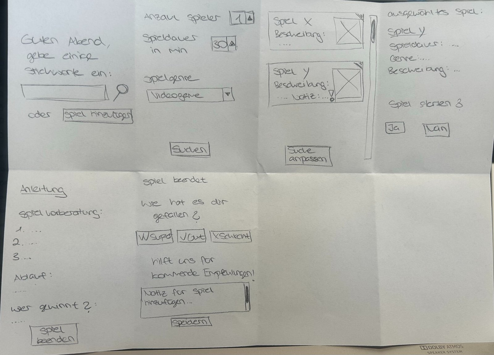
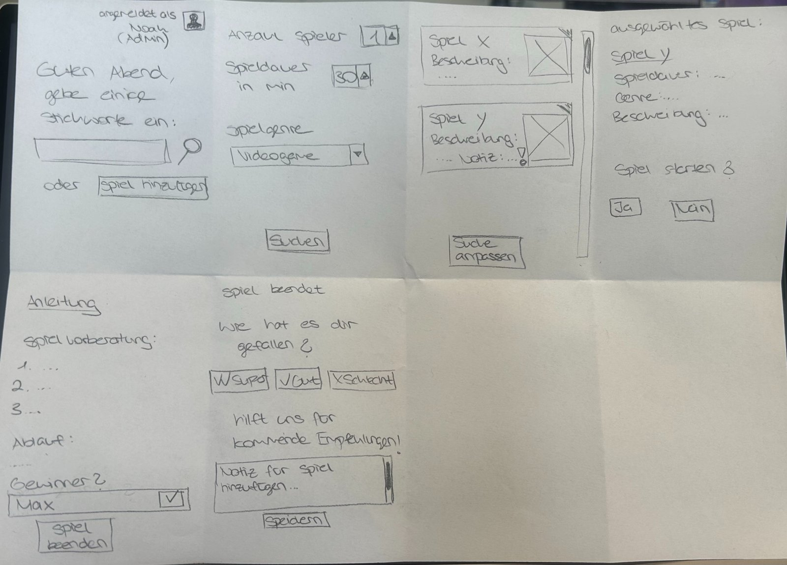
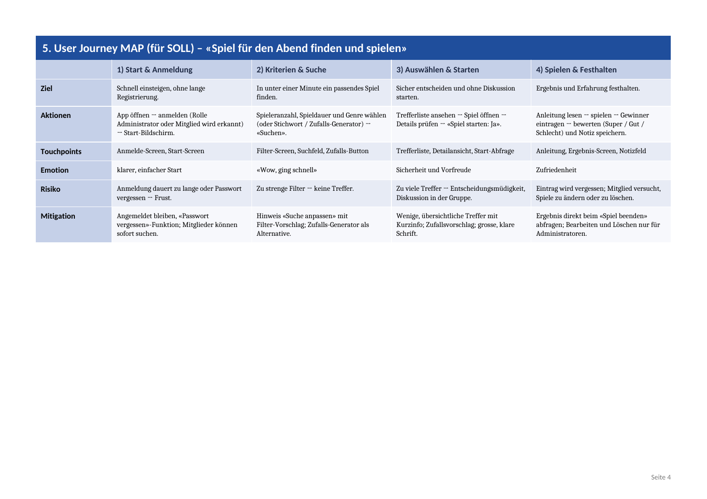

# Projektdokumentation - GameNight-Generator

## Projektübersicht & Zugänge

| Angabe | Inhalt |
|---|---|
| Projekttitel | GameNight-Generator |
| Verfasser/in | Noah Büchler,  |
| GitHub-Repository | https://github.com/buechno1/GameNight |
| Aktuelle App | https://gamenight-pt.netlify.app/ |
| Getestete Version | https://gamenight-pt.netlify.app/ (Commit [8df90da](https://github.com/buechno1/GameNight/commit/8df90dac4c0b4ee83dc250fbc9e82de25d130ad1)) |
| Testzugänge | Registrierung in der App frei möglich (Rolle «Mitglied»). Admin-Testkonto: wird bei der Abgabe auf Moodle mitgeteilt. |
| Figma / Referenz-Mockup | _[Direkter Link – folgt]_ |
| Weitere Artefakte | [User Journey Map (Bild)](docs/user-journey-map.png), [Skizze vor den Kommentaren](docs/crazy8s-flow-vorher.jpg), [Skizze nach den Kommentaren](docs/skizze-nachher.jpg) |

## Inhaltsverzeichnis

[Projektübersicht & Zugänge](#projektübersicht--zugänge)

1. [Ausgangslage](#1-ausgangslage)
2. [Lösungsidee](#2-lösungsidee)
3. [Vorgehen & Artefakte](#3-vorgehen--artefakte)
    1. [Understand & Define](#31-understand--define)
    2. [Sketch](#32-sketch)
    3. [Decide](#33-decide)
    4. [Prototype](#34-prototype)
    5. [Validate](#35-validate)
4. [Erweiterungen](#4-erweiterungen)
5. [KI-Deklaration](#5-ki-deklaration)
6. [Anhang](#6-anhang)

## 1. Ausgangslage

Vor jedem Spieleabend steht man oft vor einer unübersichtlichen Auswahl an Brett- oder Videospielen. Welche Spiele passen zur Anzahl anwesender Personen, wie viel Zeit steht zur Verfügung und welches Genre ist erwünscht? Manuell wälzt man Regale oder durchsucht digitale Sammlungen, was zu langen Diskussionen oder frustrierenden Kompromissen führt. Im Nachhinein fehlt zudem oft eine verlässliche Historie darüber, wer welche Runde gewonnen hat oder welche Spiele oft auf den Tisch kommen.

- **Problem:** Die Spielauswahl vor dem Spieleabend dauert zu lange. Bestehende Plattformen wie BoardGameGeek sind überladen und eher Datenbanken als spontane Entscheidungshilfen. Ergebnisse und Erfahrungen vergangener Abende gehen verloren.
- **Ziele:**
  - In unter einer Minute ein passendes Spiel finden (Filter nach Spieleranzahl, Spieldauer und Genre, ergänzt durch einen Zufalls-Generator).
  - Spiele einfach erklärt abrufen (Anleitung in Schritten).
  - Gewinner, Bewertung und Notizen jeder Runde festhalten und als Statistik auswerten.
  - Die Spielesammlung vor unbefugten Änderungen schützen (Anmeldung mit Rollen).
- **Primäre Zielgruppe:** Brettspiel-Enthusiasten, Gamer und Freundesgruppen, die regelmässig (wöchentlich oder monatlich) Spieleabende veranstalten, sowie Gelegenheitsspielende und Hobbyspielende, die schnell eine Entscheidung brauchen. Der Einsatz erfolgt direkt vor dem Spieleabend, meist im Wohnzimmer am Smartphone, Tablet oder Laptop.
- **Weitere Stakeholder [Optional]:** Mitspielende (Familie, Enkel, Seniorentreff), die über die Anleitung ins Spiel finden.

## 2. Lösungsidee

Der **GameNight-Generator** ist eine Web-App, die aus einer Spielesammlung in der Datenbank in wenigen Schritten das passende Spiel für den Abend findet und die Ergebnisse festhält.

- **Kernfunktionalität:**
  1. **Suchen & Filtern:** Spieleranzahl, maximale Dauer, Genre und Stichwort. Die Trefferliste aktualisiert sich live. Alternativ schlägt der **Zufalls-Generator** ein passendes Spiel vor.
  2. **Spiel starten:** Aus der Detailansicht wird mit «Spiel starten: Ja/Nein» bestätigt, danach erscheint die **Anleitung in einfachen Schritten** (Vorbereitung, Ablauf, Spielende, Tipps).
  3. **Spiel beenden:** Gewinner wählen, bewerten (Super / Gut / Schlecht) und eine Notiz speichern.
  4. **Historie & Gewinner:** Rangliste der Gewinner, meistgespielte Spiele und Verlauf aller Runden mit Suchfeld.
  5. **Anmeldung mit Rollen:** Gäste können nur suchen. Mitglieder können zusätzlich Runden, Bewertungen und Notizen speichern. Nur **Administratoren** dürfen Spiele hinzufügen, bearbeiten und löschen. Die Registrierung ist in der App möglich.
- **Annahmen:** Eine Kombination aus harten Filtern und einem Zufallselement hilft der Gruppe, Entscheidungsträgheit zu überwinden. Eine kurze, schrittweise Anleitung reduziert den Erklärungsaufwand, besonders für Personen, die Regeln vergessen haben.
- **Abgrenzung:** Es erfolgt keine Anbindung an externe Spieldatenbanken (z. B. BoardGameGeek), keine Online-Mehrspielerfunktion und keine Verwaltung von Besitz oder Ausleihe der Spiele. Zudem sind die Spiele physisch nötig, auf der Website selbst lassen sich die Spiele nicht direkt spielen.

## 3. Vorgehen & Artefakte

Die Durchführung erfolgte phasenbasiert (Understand & Define, Sketch, Decide, Prototype, Validate).

### 3.1 Understand & Define

- **Zielgruppenverständnis:**

  **Problemraum:** Unübersichtliche Spielauswahl vor dem Spieleabend, lange Diskussionen und fehlende Historie vergangener Runden.

  **Nutzer, Bedürfnisse, Kontext, Herausforderungen:**
  - Primäre Nutzer: Brettspiel-Enthusiasten, Gamer und Freundesgruppen mit regelmässigen Spieleabenden.
  - Bedürfnisse: schnelle, unkomplizierte Entscheidung; Filterung nach harten Fakten (Spieleranzahl, Dauer, Komplexität); Festhalten von Erfolgen, Gewinnern und Erfahrungen.
  - Kontext: direkt vor dem Spieleabend, meist im Wohnzimmer oder am Computer, wenn die Gruppe bereits wartet.
  - Herausforderung: Die Bedienung muss extrem schnell und intuitiv sein, da niemand lange Daten eingeben möchte, während die Mitspielenden warten.

  **How Might We:**
  - Wie könnten wir den Auswahlprozess so spielerisch und schnell gestalten, dass die Gruppe in unter einer Minute das perfekte Spiel findet?
  - Wie könnten wir eine unstrukturierte Spielesammlung so übersichtlich in einer Datenbank erfassen, dass Filter (Spieleranzahl, Zeit) sekundenschnell greifen?
  - Wie könnten wir die Historie vergangener Spielabende so dokumentieren, dass Rivalitäten und Sieger-Statistiken ersichtlich werden?

  **Proto-Personas:**

  | | **Lukas (32)** | **Sarah (27)** | **Helga (68)** |
  |---|---|---|---|
  | **Rolle / Profil** | Brettspiel-Enthusiast, Organisator der wöchentlichen Spielegruppe | Gelegenheitsspielerin, Mitglied in verschiedenen Freundesgruppen | Hobbyspielerin, Oma, Mitglied im lokalen Seniorentreff |
  | **Eigenschaften** | Gesellig, gut organisiert, leidenschaftlicher Gamer, schätzt Statistiken und Wettbewerb | Pragmatisch, entscheidungsmüde nach dem Arbeitstag, sucht unkomplizierte Unterhaltung | Geduldig, schätzt Geselligkeit, wird von langen und verschachtelten Regeltexten schnell überfordert, sucht klare Strukturen |
  | **Umfeld (Kontext)** | Hostet regelmässig Spieleabende zu Hause. 3–6 Freunde warten am Tisch. Zugriff spontan per Smartphone oder Laptop. | Trifft sich spontan unter der Woche oder am Wochenende. Nutzt digitale Sammlungen oder Klassiker aus dem Regal. Unter Zeitdruck sinkt die Stimmung. | Spielt mit Enkeln oder Gleichaltrigen. Holt Spiele erst nach langer Zeit wieder hervor und hat die Regeln vergessen. Nutzt Smartphone oder Tablet am Esstisch. |
  | **Ziele** | Schnelle Entscheidung ohne langes Suchen; passendes Spiel nach Personenanzahl, Dauer und Komplexität; Erfolge und Sieger-Statistiken festhalten | In unter einer Minute das passende Spiel finden; Mischung aus Filtern und Überraschungsmoment; minimaler Aufwand beim Erfassen | Auf einen Blick verstehen, worum es geht; leicht verständliche Spiele mit wenig Vorbereitung; ohne fremde Hilfe eine passende Spielidee wählen |
  | **Aufgaben** | Spieledatenbank pflegen; filtern oder Zufall nutzen; Gewinner und Ergebnisse eintragen | Kriterien wie «exakt 4 Spieler, max. 40 Minuten» eingeben; Zufallsvorschlag präsentieren; kurze Notizen festhalten | Nach einfach erklärten Spielen suchen; Kurz-Anleitung abrufen; Notizen speichern, welches Spiel den Enkeln am meisten Spass machte |
  | **Frustpunkte** | Lange Diskussionen und Kompromisse; überladene Plattformen wie BoardGameGeek; fehlende Historie | Aufwändige Dateneingabe, während alle warten; Regeln wälzen; unübersichtliche Sammlungen | Kleingedruckte, komplizierte Regelhefte; überladene Oberflächen mit kleiner Schrift; Sorge, dass das Erklären zu lange dauert |

- **Wesentliche Erkenntnisse:**
  - Bestehende Lösungen (z. B. BoardGameGeek) sind überladen und eher Datenbanken als spontane Entscheidungshelfer.
  - Nutzende schätzen die Mischung aus gezielten Filtern (z. B. exakt 4 Spieler, max. 60 Minuten) und einem Zufallselement, um Entscheidungsträgheit zu brechen.
  - Das Erfassen von Spielen muss mit wenigen Klicks möglich sein (Titel, Spieler von–bis, Dauer, Genre), sonst wird das Tool nicht gepflegt.
  - Alle drei Personas teilen dasselbe Kernproblem: Die Auswahl dauert zu lange. Helga braucht zusätzlich eine einfache, schrittweise Anleitung, Lukas eine Historie mit Statistiken.

### 3.2 Sketch

- **Variantenüberblick:** In der Skizzenphase (Crazy 8s) wurde statt acht einzelner Ideen direkt der gesamte Ablauf der App skizziert (Wahl-Option der Übung). Es gab daher keine alternativen Varianten, sondern eine Skizze, die nach Kommentaren überarbeitet wurde.
- **Skizzen:**

  **Abbildung 1: Crazy 8s – Flow direkt skizziert (vor den Kommentaren)**

  

  **Abbildung 2: Ausgearbeitete Skizze (nach den Kommentaren)** mit Anmeldung («angemeldet als Noah (Admin)») und Auswahl des Gewinners

  

  **Erhaltene Kommentare und deren Umsetzung:**

  | Kommentar | Anpassung |
  |---|---|
  | Fehlende Anmeldung und Rollenvergabe: Ohne Anmeldung kann jede Person Spiele bearbeiten, löschen und hinzufügen. | Anmeldung mit Rollen in den Ablauf eingebaut. Oben links wird angezeigt, wer mit welcher Rolle angemeldet ist. |
  | Vorschlag: eintragen können, wer das Spiel gewonnen hat. | Das Feld «Wer gewinnt?» wurde durch eine Auswahl «Gewinner?» ersetzt, die vor dem Beenden des Spiels bestätigt wird. |

### 3.3 Decide

- **Gewählte Variante & Begründung:** Gewählt wurde der **komplette Ablauf der App**: «Kriterien eingeben, Spiel finden, Anleitung, Ergebnis und Bewertung festhalten». Beim Skizzieren durfte der Flow direkt Schritt für Schritt entworfen werden, so liess sich die gesamte Nutzung vom Start bis zum Spielende durchdenken. Entscheidkriterien waren die Bedürfnisse der Personas:
  - **Geschwindigkeit:** Alle Personas haben dasselbe Kernproblem, die Auswahl dauert zu lange. Deshalb steht die Suche mit den Filtern Spieleranzahl, Spieldauer und Genre am Anfang und führt in wenigen Schritten zum Spiel.
  - **Verständlichkeit:** Die Anleitung in einfachen Schritten hilft Helga, ohne dicke Regelhefte zu spielen.
  - **Statistik:** Gewinner und Notiz am Ende decken Lukas' Wunsch nach Statistiken ab und liefern die Basis für künftige Empfehlungen.
  - **Schutz der Daten (aus dem Feedback):** Anmeldung mit Rollenvergabe. Alle Mitglieder können Spiele suchen, spielen und bewerten, nur Administratoren dürfen Spiele hinzufügen, bearbeiten und löschen.

- **End-to-End-Ablauf:** User Journey Map (Soll-Zustand) «Spiel für den Abend finden und spielen»:

  | | 1) Start & Anmeldung | 2) Kriterien & Suche | 3) Auswählen & Starten | 4) Spielen & Festhalten |
  |---|---|---|---|---|
  | **Ziel** | Schnell einsteigen, ohne lange Registrierung | In unter einer Minute ein passendes Spiel finden | Sicher entscheiden und ohne Diskussion starten | Ergebnis und Erfahrung festhalten |
  | **Aktionen** | App öffnen → anmelden (Rolle Administrator oder Mitglied wird erkannt) → Start-Bildschirm | Spieleranzahl, Spieldauer und Genre wählen (oder Stichwort / Zufalls-Generator) → «Suchen» | Trefferliste ansehen → Spiel öffnen → Details prüfen → «Spiel starten: Ja» | Anleitung lesen → spielen → Gewinner eintragen → bewerten (Super / Gut / Schlecht) und Notiz speichern |
  | **Touchpoints** | Anmelde-Screen, Start-Screen | Filter-Screen, Suchfeld, Zufalls-Button | Trefferliste, Detailansicht, Start-Abfrage | Anleitung, Ergebnis-Screen, Notizfeld |
  | **Emotion** | Klarer, einfacher Start | «Wow, ging schnell» | Sicherheit und Vorfreude | Zufriedenheit |
  | **Risiko** | Anmeldung dauert zu lange oder Passwort vergessen → Frust | Zu strenge Filter → keine Treffer | Zu viele Treffer → Entscheidungsmüdigkeit, Diskussion in der Gruppe | Eintrag wird vergessen; Mitglied versucht, Spiele zu ändern oder zu löschen |
  | **Mitigation** | Angemeldet bleiben (Sitzung 7 Tage); Gäste können sofort suchen | Hinweis bei fehlenden Treffern; Zufalls-Generator als Alternative | Wenige, übersichtliche Treffer mit Kurzinfo; Zufallsvorschlag; grosse, klare Schrift | Ergebnis direkt beim «Spiel beenden» abfragen; Bearbeiten und Löschen nur für Administratoren |

  

- **Mockup:** Link siehe «Figma / Referenz-Mockup» in der [Projektübersicht](#projektübersicht--zugänge).

  _[Screenshots mit kurzen Beschreibungen – folgen mit dem Mockup]_

### 3.4 Prototype

#### 3.4.1. Entwurf (Design)

- **Informationsarchitektur:**

  | Seite | Pfad | Zugriff | Zweck |
  |---|---|---|---|
  | Spielsuche | `/` | alle | Filter, Zufalls-Generator, Spielkarten. Admin: Spiele hinzufügen, bearbeiten, löschen |
  | Spieldetail / Spielablauf | `/spiel/[id]` | alle (Speichern nur Mitglieder) | Spiel starten → Anleitung → Spiel beenden (Gewinner, Bewertung, Notiz) |
  | Historie & Gewinner | `/historie` | angemeldet | Rangliste, meistgespielte Spiele, Verlauf. Admin: Einträge löschen |
  | Anmelden | `/login` | alle | Anmeldung |
  | Registrieren | `/register` | alle | Konto anlegen (Rolle «Mitglied») |

  Die Navigation (Spielsuche, Historie & Gewinner, Anmelden / Registrieren / Abmelden) ist auf allen Seiten oben sichtbar. Rechts oben steht, wer mit welcher Rolle angemeldet ist.

  | Funktion | Gast | Mitglied | Admin |
  |---|:-:|:-:|:-:|
  | Spiele suchen, filtern, Zufalls-Generator, Anleitung lesen | ✓ | ✓ | ✓ |
  | Runde speichern (Gewinner, Bewertung, Notiz), Historie sehen | – | ✓ | ✓ |
  | Spiele hinzufügen, bearbeiten, löschen | – | – | ✓ |
  | Historie-Einträge löschen | – | – | ✓ |

- **User Interface Design:** _[wichtige Screens: Screenshots mit kurzen Erläuterungen – folgen]_
- **Designentscheidungen:**
  - **Dunkles «Glas»-Design** mit Farbverlauf und sanft schwebenden Emoji im Hintergrund: spielerisch, originell und trotzdem gut lesbar.
  - **Live-Filter**: Die Trefferliste reagiert sofort auf jede Eingabe, damit die Auswahl in unter einer Minute gelingt.
  - **Zufalls-Generator** mit kurzer Drehanimation als Überraschungsmoment gegen Entscheidungsträgheit.
  - **Anleitung in Schritten** (nummerierte Vorbereitung und Ablauf, Spielende als Fliesstext), damit auch Helga die Regeln schnell versteht.
  - **Geführter Ablauf** in der Detailansicht (Spiel starten → Anleitung → Spiel beenden), entsprechend der User Journey Map.
  - **Bilder pro Spiel:** eigene Genre-Illustrationen als Fallback, individuelle Bilder werden automatisch aus `static/games/` zugeordnet.
  - **Spielerzahl-Anzeige:** Bei fester Spielerzahl steht «2» statt «2–2».
  - **Bootstrap 5** für Raster, Formulare und Schaltflächen (responsive für Smartphone, Tablet und Laptop).

#### 3.4.2. Umsetzung (Technik)

- **Technologie-Stack:** SvelteKit 3 (verbindliche Vorgabe) mit Svelte 5 (Runes), JavaScript. Zusätzlich: Bootstrap 5 (UI), MongoDB Atlas mit dem offiziellen `mongodb`-Treiber (Datenbank), `adapter-netlify` (Deployment auf Netlify).
- **Tooling:** Visual Studio Code, Git und GitHub, MongoDB Compass (Dateneinsicht), Netlify (Hosting). Der Einsatz von KI wird im Kapitel [KI-Deklaration](#6-ki-deklaration) beschrieben.
- **Vorgehen bei der Implementierung:**
  1. Projekt mit `sv create` aufgesetzt (ohne Drizzle/Better Auth, da MongoDB statt SQL verwendet wird), GitHub-Repository und Netlify-Deployment eingerichtet.
  2. MongoDB-Atlas-Datenbank erstellt, Verbindung über `DB_URI` (`.env`) getestet.
  3. Spielsuche, Detailablauf, Historie sowie Anmeldung und Rollen mit KI-Unterstützung implementiert, schrittweise im Projekt eingefügt und im Browser geprüft.
  4. Rückmeldungen aus dem Testen (z. B. schlecht lesbare Texte, fehlende Bilder, zu kurze Anleitungen, Aufzählungszeichen beim Spielende, «2–2») wurden iterativ eingearbeitet.
  5. Beispieldaten (42 Spiele) über ein Seed-Skript eingespielt, damit die App getestet werden kann.

  Für Details zum Zusammenspiel von eigener Arbeit und KI siehe Kapitel [6](#6-ki-deklaration).
- **Struktur & Komponenten:** Die App besteht aus fünf Seiten, einer gemeinsamen Hilfsbibliothek und einem Skript für die Beispieldaten.

  | Datei / Ordner | Aufgabe |
  |---|---|
  | `src/routes/+page.svelte` und `+page.server.js` | **Spielsuche** (Startseite): Filter, Zufalls-Generator, Spielkarten. Admin: Spiele hinzufügen, bearbeiten, löschen |
  | `src/routes/spiel/[id]/` | **Spielablauf**: Spiel starten, Anleitung, Spiel beenden (Gewinner, Bewertung, Notiz speichern) |
  | `src/routes/historie/` | **Historie & Gewinner**: Rangliste, meistgespielte Spiele, Verlauf |
  | `src/routes/login/`, `register/`, `logout/` | **Anmeldung**, Registrierung, Abmeldung |
  | `src/routes/+layout.svelte` und `+layout.server.js` | Navigation, Hintergrund und Stile für alle Seiten. Übergibt den angemeldeten Benutzer |
  | `src/hooks.server.js` | Liest bei jeder Anfrage das Sitzungs-Cookie und setzt den angemeldeten Benutzer |
  | `src/lib/games.js` | Hilfsfunktionen: Spielbilder, Spielerzahl-Anzeige, Anleitung aufbereiten, Bewertungen |
  | `src/lib/server/db.js` | Verbindung zur MongoDB-Datenbank |
  | `src/lib/server/auth.js` | Passwort-Hash (scrypt) und Sitzungen |
  | `static/genres/` | 14 eigene Genre-Illustrationen (SVG) |
  | `static/games/` | Spielbilder (`<spielname>.png`), werden automatisch zugeordnet |
  | `scripts/seed.mjs`, `games-extra.mjs` | Beispieldaten in die Datenbank einspielen: 42 Spiele und Beispiel-Runden für die Historie |

  Zustand wird mit Svelte-5-Runes (`$state`, `$derived`) verwaltet, Formulare laufen über SvelteKit Form Actions mit `use:enhance`.
- **Daten & Schnittstellen:** Die Daten liegen in MongoDB Atlas (Datenbank `GameNight`) und werden serverseitig über `load`-Funktionen gelesen und über Form Actions geschrieben. Es gibt keine separate REST-API.

  | Collection | Inhalt |
  |---|---|
  | `games` | Titel, Spieler (min/max), Dauer, Genre, Beschreibung, Anleitung, optional Bild |
  | `users` | Benutzername, Passwort-Hash und Salt, Rolle (`member` oder `admin`) |
  | `sessions` | Sitzungs-Token, Benutzer, Ablaufdatum (7 Tage) |
  | `rounds` | gespielte Runden: Spiel, Gewinner, Bewertung, Notiz, Benutzer, Datum |

  **Anmeldung und Rollen:** Eigene Umsetzung. Das Passwort wird mit scrypt und Salt gehasht, die Sitzung als `httpOnly`-Cookie (`sameSite=lax`) gespeichert. Die Rolle wird bei jeder Anfrage frisch aus der Datenbank gelesen. Alle Schreibaktionen prüfen die Berechtigung **serverseitig** (nicht nur durch ausgeblendete Schaltflächen). Die Rolle `admin` wird bewusst nicht über die Registrierung vergeben, sondern direkt in der Datenbank gesetzt.
- **Deployment:** Link siehe «Aktuelle App» in der [Projektübersicht](#projektübersicht--zugänge). Das Deployment erfolgt automatisch aus dem GitHub-Repository über Netlify (`adapter-netlify`). Die Umgebungsvariable `DB_URI` ist in Netlify hinterlegt, in Atlas ist der Netzwerkzugriff für Netlify freigegeben. Die `.env`-Datei ist über `.gitignore` vom Repository ausgeschlossen.
- **Besondere Entscheidungen:**
  - **MongoDB statt SQL**, daher kein Drizzle und kein Better Auth. Die Anmeldung wurde stattdessen selbst umgesetzt, da sie zur Collection-Struktur passt und die Rollenlogik einfach bleibt.
  - **Eigene Illustrationen statt Spielschachtel-Bildern** (Urheberrecht). Eigene Bilder können mit dem Spielnamen als Dateiname in `static/games/` abgelegt werden.
  - **Spielbeschreibungen und Anleitungen in eigenen Worten** (keine Übernahme von Original-Regelheften).
  - **Seed-Skript** statt manueller Dateneingabe, damit die App sofort testbar ist.
  - **Vereinfachungen:** Der Benutzername ist über die Anwendungslogik eindeutig (nicht über einen Datenbank-Index). Kein «Passwort vergessen».

### 3.5 Validate

- **Getestete Version:** Separat deployt; Link und Commit/Tag siehe «Getestete Version» in der [Projektübersicht](#projektübersicht--zugänge).
- **Ziele der Prüfung:** _[folgt]_
- **Vorgehen:** _[folgt]_
- **Stichprobe:** _[folgt]_
- **Aufgaben/Szenarien:** _[folgt]_
- **Kennzahlen & Beobachtungen:** _[folgt]_
- **Nachweise:** _[folgt]_
- **Zusammenfassung der Resultate:** _[folgt]_
- **Abgeleitete Verbesserungen:** _[folgt]_

## 4. Erweiterungen

> Entwurf: Die folgenden Einträge sind Vorschläge, welche Teile über den Mindestumfang hinausgehen könnten. Screenshots und Codeverweise sind noch zu ergänzen, bei Nichtgebrauch einfach löschen.

### 4.1 Software-Erweiterungen

#### 4.1.1 Anmeldung, Registrierung und Rollenkonzept

- **Beschreibung & Nutzen:** Registrierung, Anmeldung und Abmeldung mit Rollen (Gast, Mitglied, Admin). Schützt die Spielesammlung vor unbefugten Änderungen und trennt persönliche Einträge von der Suche.
- **Abgrenzung zum Mindestumfang:** Der Mindestumfang verlangt Daten erfassen und bearbeiten. Ein eigenes Rollen- und Sitzungssystem mit gehashten Passwörtern geht darüber hinaus.
- **Umsetzung:** `src/hooks.server.js`, `src/lib/server/auth.js`, `src/routes/login/`, `src/routes/register/`, `src/routes/logout/`. Berechtigungsprüfung in den Actions von `src/routes/+page.server.js` und `src/routes/historie/+page.server.js`.
- **Nachweise:** _[Screenshots: Registrierung, Anmeldung, Admin-Ansicht vs. Gast-Ansicht; Codeverweise mit Links ergänzen]_
- **Bezug zur Evaluation:** Nein. Abgeleitet aus dem Kommentar zur Skizze (fehlende Anmeldung und Rollenvergabe).

#### 4.1.2 Historie & Gewinner-Statistik

- **Beschreibung & Nutzen:** Rangliste der Gewinner, meistgespielte Spiele und durchsuchbarer Verlauf mit Bewertung und Notiz. Deckt den Wunsch von Lukas nach Statistiken und Rivalitäten ab.
- **Abgrenzung zum Mindestumfang:** Auswertung der gespeicherten Daten (Aggregation, Balkendiagramme) über das reine Erfassen hinaus.
- **Umsetzung:** `src/routes/historie/+page.server.js` und `+page.svelte`, Speicherung in `src/routes/spiel/[id]/+page.server.js` (Action `finish`).
- **Nachweise:** _[Screenshot der Historie-Seite; Codeverweise ergänzen]_
- **Bezug zur Evaluation:** Nein. Abgeleitet aus den Personas und dem Kommentar «Gewinner eintragen».

#### 4.1.3 Automatische Spielbilder und Genre-Illustrationen

- **Beschreibung & Nutzen:** Jedes Spiel zeigt ein Bild. Liegt unter `static/games/<spielname>.png` eine Datei, wird sie automatisch verwendet, sonst eine eigene Genre-Illustration. Das macht die Auswahl anschaulicher und vermeidet Urheberrechtsprobleme.
- **Abgrenzung zum Mindestumfang:** Visuelle Aufwertung und automatische Zuordnung ohne manuelles Hinterlegen jedes Bildpfads.
- **Umsetzung:** `src/lib/games.js` (`imageCandidates`, `nextImage`), `static/genres/*.svg`.
- **Nachweise:** _[Screenshot der Spielkarten; Codeverweise ergänzen]_
- **Bezug zur Evaluation:** Nein.

_[folgt, z. B. weitere Methoden oder Planungsartefakte]_

## 5. KI-Deklaration

Im Projekt wurde KI eingesetzt. Die Arbeitsweise ist nachfolgend beschrieben.

### 5.1 KI-Tools

- **Eingesetzte Tools:** Claude (Anthropic), im Chat mit Dateizugriff und Codeausführung; Modell: Claude Sonnet 5.5 _[Version prüfen und ggf. anpassen]_.
- **Zweck & Umfang:**
  - **Dokumentation:** Gestaltung und Layout der PDF-Projektdokumentation (Personas, Skizzen, Kommentare, User Journey Map) sowie dieser README aus meinen Unterlagen.
  - **Code:** Erstellung des Grossteils des Quellcodes der App (Seiten, Server-Logik, Anmeldung und Rollen, Hilfsfunktionen, Stile) auf Basis meiner Anforderungen.
  - **Inhalte:** Beschreibungen und Anleitungen der Beispiel-Spiele, Seed-Skript und die Genre-Illustrationen (SVG).
  - **Beratung:** Hilfe beim Projekt-Setup (SvelteKit-Optionen, MongoDB-Anbindung, `.env`, Netlify) und bei Fehlermeldungen.
- **Eigene Leistung (Abgrenzung):** Ideenfindung, Problemraum, Personas, Skizzen und die Entscheidung für den Ablauf, Einarbeitung der Kommentare, Anforderungen an die App (Rollen, Registrierung, Optik, Bilder, Datenmenge), Einrichtung von Projekt, MongoDB Atlas, GitHub und Netlify, Einfügen und Testen des Codes im Browser, Rückmeldungen und Korrekturwünsche, Bereitstellung der Spielbilder. _[Ergänzen, was du selbst angepasst oder geschrieben hast]_

### 5.2 Vorgehen mit KI

- **Arbeitsablauf & Aufgabenverteilung:** Ich habe Anforderungen und Unterlagen im Chat bereitgestellt. Die KI erzeugte Code und Dokumente, ich fügte sie ins VS-Code-Projekt ein, testete lokal und auf Netlify und meldete Fehler oder Änderungswünsche mit Screenshots zurück. Es wurde in kleinen Schritten iteriert (Updates mit jeweils wenigen geänderten Dateien). Die KI hatte keinen direkten Zugriff auf mein Repository oder meine Datenbank.
- **Prompt-Vorgehen & Kontext:** Kontext bestand aus meinen Dokumenten (Ideenfindung, PDF-Vorlagen, Anforderungen), Screenshots von Fehlern und der App sowie kurzen Änderungswünschen. Beispiel: «Ich möchte, dass man ohne Anmeldung nur Spiele suchen kann, aber keine Notizen hinzufügen oder Spiele ändern kann.»
- **Konfiguration & Werkzeuge:** Keine (keine Agenten-Konfiguration oder Kontextdateien im Repository).
- **Prüfung & Überarbeitung:** Der Code wurde von mir im Browser getestet (Gast, Mitglied, Admin). Fehler (z. B. nicht mehr unterstütztes `$lib`, schlecht lesbarer Text, falsche Darstellung «2–2») wurden gemeldet und korrigiert. Spielregeln und Beschreibungen sind in eigenen Worten formuliert; Ich habe die Anleitungen der Spiele mit den Originalregeln verglichen. Diese stimmen überein, sind jedoch etwas gekürzt da sonst die ganze Seite zu unübersichtlich werden würde. Original-Spielbilder wurden aus Urheberrechtsgründen nicht von der KI erzeugt oder kopiert.

### 5.3 Reflexion

_[Nutzen, Grenzen, Risiken/Qualitätssicherung – folgt]_

## 6. Anhang

**Quellen und Lizenzen**

| Inhalt | Quelle / Link | Lizenz bzw. Nutzungsbedingungen |
|---|---|---|
| SvelteKit / Svelte | https://svelte.dev | MIT |
| Bootstrap 5 | https://getbootstrap.com | MIT |
| MongoDB Node.js Driver | https://www.mongodb.com | Apache 2.0 |
| Genre-Illustrationen (`static/genres/*.svg`) | Eigene Erstellung (mit KI-Unterstützung) | eigene Arbeit |
| Spielbilder (`static/games/*.png`) | https://pixabay.com/images/search/ | Pixabay-Lizenz, ohne Namensnennung nutzbar |
| Spieltitel | Nur als Titel genannt. Die Marken gehören den jeweiligen Rechteinhabern. Beschreibungen und Anleitungen sind in eigenen Worten verfasst. | – |
| Emoji | Darstellung durch das System des Endgeräts | – |

